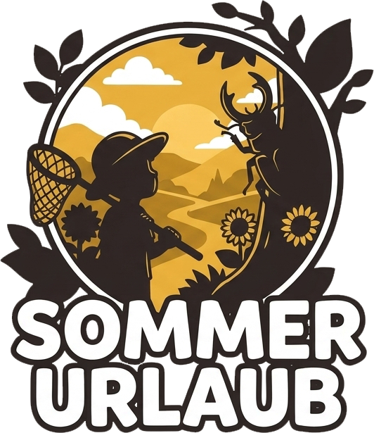

<p align="center">
  
</p>

<h1 align="center">Projekt SOMMERURLAUB</h1>

<p align="center">
  <strong>Vollständige deutsche Fan-Übersetzung von <em>Boku no Natsuyasumi</em> (PS1, SCPS-10088)</strong><br>
  <em>31 Sommertage auf dem Land – komplett auf Deutsch spielbar (Dialoge, Menüs, Texturen, Tagebuch, Lexika &amp; Untertitel).</em>
</p>

<p align="center">
  <a href="../../releases"><strong>Patch herunterladen (Releases)</strong></a> ·
  <a href="#installation--anleitung">Anleitung</a> ·
  <a href="#prüfsummen-sha-1">Prüfsummen</a> ·
  <a href="#licenses--credits">Licenses &amp; Credits</a>
</p>

---

## Was ist Projekt SOMMERURLAUB?

**Projekt SOMMERURLAUB** ist ein deutscher Fan-Übersetzungspatch für das PlayStation-1-Original von *Boku no Natsuyasumi* (ぼくのなつやすみ, SCEI / Millennium Kitchen, 2000, **SCPS-10088**): Ein neunjähriger Junge verbringt den August 1975 bei seinem Onkel auf dem Land – 31 Tage voller Käferfang, Käfer-Sumo, Drachensteigen, Angeln und Bildertagebuch.

- **Alle 2.801 Dialog- & Ereigniszeilen** (`shared.txt` + `day01.txt`–`day31.txt`) im Dual-Source-Verfahren direkt gegen das japanische Originalskript übersetzt.
- **Alle 314 UI-, Menü-, Item- & Enzyklopädie-Einträge** (`arrays.txt`), inkl. aller 57 Insektennamen, Fische, Drachen und Memory-Card-Texte.
- **Alle 300 Textur-Texte** (`textures/`): Titelmenü, Stein-Buttons, Schilder, Rekorde, Käfer-Sumo-HUD, Drachen-HUD, Insekten- & Drachen-Lexikon sowie alle **93 Seiten von Bokus Bildertagebuch**.
- **Alle 89 Film- & Sprachclip-Untertitel** (`movies.txt` & `clips.txt`): Intro (`M27`), Abspann (`M28`), Titelsong, Zwischensequenzen, Käfer-Sumo-Rufe und alle **5 End-Epiloge** (`XCH.41`–`XCH.45`). Die japanische Sprachausgabe bleibt bewusst erhalten.
- **Nichts gekürzt („Nothing is cut to fit“):** Überlange Text-Container werden automatisch reloziert; alle Spielfonts (`VWF`, `GameFace`, `Bean`/`Sprout`) unterstützen echte deutsche Umlaute und Eszett (`ä`, `ö`, `ü`, `Ä`, `Ö`, `Ü`, `ß`).

---

## Rechtlicher Hinweis / Legal Notice

> **Rechtlicher Hinweis:**  
> *Boku no Natsuyasumi* (ぼくのなつやすみ, PS1, `SCPS-10088`, 2000) ist © **Sony Interactive Entertainment** (ursprünglich Sony Computer Entertainment Inc.) und entwickelt von **Millennium Kitchen**.  
> **Projekt SOMMERURLAUB** ist ein unkommerzielles Fan-Übersetzungsprojekt und steht in keiner Verbindung zu Sony Interactive Entertainment oder Millennium Kitchen.  
> Dieses Repository und die Releases enthalten **keinerlei Original-Spieldateien**. Zur Nutzung wird eine eigene Kopie (Dump) der japanischen Original-CD benötigt.
>
> **Legal Notice:**  
> *Boku no Natsuyasumi* (ぼくのなつやすみ, PS1, `SCPS-10088`, 2000) is © **Sony Interactive Entertainment** (originally Sony Computer Entertainment Inc.) and developed by **Millennium Kitchen**.  
> **Projekt SOMMERURLAUB** is a non-commercial fan translation project and is not affiliated with or endorsed by Sony Interactive Entertainment or Millennium Kitchen.  
> This repository and its releases contain **no original game files**. A personal copy (dump) of the original Japanese disc is required to use this patch.

---

## Installation & Anleitung

### Methode 1: DuckStation (am einfachsten – ohne Zusatzprogramm)

1. Lade das `.zip`-Archiv aus den **[Releases](../../releases)** herunter und entpacke es.
2. Lege die Datei `Boku_no_Natsuyasumi_DE_SOMMERURLAUB_v1.1.0.ppf` in **denselben Ordner** wie dein japanisches Original-Spiel (z. B. `Boku no Natsuyasumi.bin` + `.cue`).
3. **Benenne die `.ppf`-Datei exakt genauso wie deine `.bin`/`.img`-Datei** (z. B. `Boku no Natsuyasumi.ppf`) – die Dateiendung `.ppf` bleibt dabei erhalten.
4. Öffne in **DuckStation** die **Einstellungen → Konsole** und setze dort den Haken bei **„Image-Patches anwenden“** (*Apply Image Patches* – ist standardmäßig **aus**!). *(Hinweis: Der Reiter „Patch-Dateien“ in den Spieleigenschaften ist nur für Cheat-Codes, nicht für `.ppf`-Dateien.)*
5. Starte das Spiel ganz normal über die `.cue` (oder `.chd`) in **DuckStation** – der Deutsch-Patch wird automatisch beim Laden angewendet.

### Methode 2: Mit GUI-Tool (`Delta Patcher` / `MultiPatch` – für alle Emulatoren)

Ideal, wenn du ein dauerhaft gepatchtes Image für **RetroArch (Beetle PSX)**, **DuckStation** oder andere Emulatoren erstellen möchtest:

1. Lade ein kostenloses GUI-Patch-Tool herunter:
   - **Windows / Linux:** [Delta Patcher](https://github.com/marco-calautti/DeltaPatcher/releases)
   - **macOS:** [MultiPatch](https://projects.saphenko.com/multipatch/)
2. Falls dein Original-Spiel als `.chd` vorliegt, entpacke es vorher mit `chdman` zu `.bin` + `.cue`.
3. *(Empfohlen)* Prüfe die SHA-1-Prüfsumme deines Original-Dumps: Sie muss exakt `5959bf7d9835d0a60aeb0143e2d0fc564bfea9fa` lauten.
4. Öffne das Patch-Tool:
   - **Original file:** Deine japanische Original-`.bin`/`.img`-Datei auswählen.
   - **XDelta patch:** `Boku_no_Natsuyasumi_DE_SOMMERURLAUB_v1.1.0.xdelta` aus dem entpackten ZIP auswählen.
   - Auf **Apply patch** klicken.
5. Benenne die fertig gepatchte Datei in `image.img` um, lege sie in denselben Ordner wie die beiliegende `image.cue` und öffne `image.cue` in **DuckStation** oder **RetroArch (Beetle PSX)**.

<details>
<summary>Alternative für Terminal-Nutzer (xdelta3 CLI)</summary>

```bash
xdelta3 -d -s "Boku no Natsuyasumi (Japan).bin" "Boku_no_Natsuyasumi_DE_SOMMERURLAUB_v1.1.0.xdelta" image.img
```

</details>

---

## Prüfsummen (SHA-1)

| Version | Original-Dump (vorher) | Gepatchtes Image (nachher) |
|---|---|---|
| Original (`SCPS-10088`) | `5959bf7d9835d0a60aeb0143e2d0fc564bfea9fa` | `5959bf7d9835d0a60aeb0143e2d0fc564bfea9fa` |
| **SOMMERURLAUB v1.1.0** | `5959bf7d9835d0a60aeb0143e2d0fc564bfea9fa` | `c08431a6b9c8d35547e28cd0aec3639c580d14eb` |
| **SOMMERURLAUB v1.0.0** | `5959bf7d9835d0a60aeb0143e2d0fc564bfea9fa` | `eaddd03ef086c2af85c627c8af81b3edbe5a65f3` |

---

## Licenses & Credits

This project is based on **[jeapostrophe/boku-ps1](https://github.com/jeapostrophe/boku-ps1)** by **Jay McCarthy** (including the foundational research and credits to `pleonex`, `HilltopWorks`, `GriffithVIII`, `psyouloveme`, `KendritPy`, and `snake7594`; see [research/related-projects.md](research/related-projects.md)). For **Projekt SOMMERURLAUB**, the entire script, glossary, style guide, pipeline/linter rules, and textures were translated and adapted into German.

The **dual license** of the upstream project applies:
- **Code, build tools, scripts & assembly patches:** [MIT License](LICENSE) ([opensource.org/licenses/MIT](https://opensource.org/licenses/MIT))
- **Translation script & context notes (`translation/`):** [CC BY-SA 4.0](LICENSE-translation) ([creativecommons.org/licenses/by-sa/4.0/](https://creativecommons.org/licenses/by-sa/4.0/))
